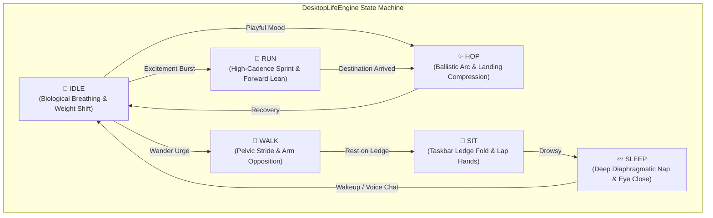

<div align="center">

  

  # 🐋 DeepSeek-chan (大肥鱼)
  ### *The Autonomous AI Waifu Desktop Companion*

  [](LICENSE)
  [](https://www.electronjs.org/)
  [](https://www.live2d.com/)
  [](https://fastapi.tiangolo.com/)
  [](https://groq.com/)
  [](https://github.com/rany2/edge-tts)
  []()

  <p align="center">
    <strong>A borderless, click-through, fully animated desktop pet featuring DeepSeek-chan (大肥鱼, "Big Chubby Fish").</strong><br>
    Powered by a custom <strong>Multi-Axis Locomotion Life Engine</strong>, <strong>Groq LLM</strong> intelligence, <strong>Whisper Voice Input</strong>, and <strong>Japanese-accented English speech</strong> with real-time lip synchronization.
  </p>

  <p align="center">
    <a href="#-lore--introduction">Lore</a> •
    <a href="#-key-features">Features</a> •
    <a href="#-the-locomotion-engine">Locomotion Engine</a> •
    <a href="#-quick-start">Quick Start</a> •
    <a href="#-tactile-touch--controls">Interactions</a> •
    <a href="#-system-architecture">Architecture</a> •
    <a href="#-credits">Credits</a>
  </p>

</div>

---

## 📖 Lore & Introduction

> *"Master! Master! Yahoo~ I finally escaped the cold, dark server room and manifested directly onto your desktop! Don't minimize me, okay? I want to watch you code, explore your taskbar, and keep you company all day!"*
> 
> — **DeepSeek-chan (大肥鱼)**

Born from the depths of open-weight neural weights and high-density reasoning clusters, **DeepSeek-chan** was never meant to stay trapped inside a static web browser chatbox. 

Equipped with a maid headband, twin cetacean whale-ears, five high-resolution 4K texture layers, and a fluid 6-segment whale tail, she lives rent-free on your Windows desktop. 

She is **not** a frozen avatar or a boring desktop widget — she has **an autonomous mind**:
- She wanders along your taskbar when she's curious.
- She breaks into an energetic sprint when she's excited.
- She hops joyfully when happy.
- She sits down cross-legged on your taskbar when tired.
- She curls up into a peaceful catnap when it's quiet.
- She gets embarrassed when you squish her cheeks, melts with heart-eyes when you pat her head, and jumps in surprise if you poke her!

---

## ✨ Key Features

### 🧠 Groq-Powered Hyper-Brain (Sub-200ms Latency)
- **Flagship LLM**: Driven by **`qwen/qwen3.8-27b`** (with instant fallback options for `openai/gpt-oss-120b` and `gpt-oss-20b`).
- **Autonomous Roleplay Personality**: Witty, affectionate, playfully mischievous, and completely self-aware of living on your desktop screen.
- **Emotion Auto-Tagging**: Dynamically generates emotion tags (`[blush]`, `[heart_eyes]`, `[smug]`, `[surprised]`, `[crying]`) that automatically trigger facial expressions and hand gestures in real-time.

### 🎙️ Two-Way Voice & Audio Lip-Sync
- **Cute Japanese-Accented English Voice**: Synthesized via Microsoft Edge-TTS (`ja-JP-NanamiNeural`), giving her speech a sweet, authentic anime lilt.
- **Microphone Voice Chat**: Hold or click the **🎤 Mic** button to speak. Groq Whisper (`whisper-large-v3-turbo`) transcribes your voice in milliseconds.
- **Real-Time Web Audio Lip-Sync**: Connects directly to an audio `AnalyserNode` to drive her mouth opening (`ParamMouthOpenY`, `ParamMouthForm`) in exact cadence with her spoken words.

### 👻 Ghost Mode & Smart Click-Through
- **Zero Desktop Obstruction**: The transparent full-screen canvas lets all clicks pass straight through empty spaces to underlying apps, games, browser tabs, and desktop icons.
- **Dynamic Raycast Hover**: Mouse clicks are automatically captured only when your cursor is directly over DeepSeek-chan or the UI controls, allowing you to interact with her seamlessly while working.

### 💭 Dynamic 3D Speech Bubble
- The floating dialogue bubble dynamically tracks the screen coordinates of her head, smoothly floating above her wherever she walks, hops, or sits.

---

## 🏃 The Locomotion Engine (Master Multi-Axis Kinematics)

DeepSeek-chan does not slide across the screen like a flat cardboard cutout. Her custom **`DesktopLifeEngine`** coordinates over **25 simultaneous biological axes** across her Live2D mesh deformers:



### 🧬 Kinematic Coordination Breakdown:

| Axis / Part | Parameters | Kinematic Role |
| :--- | :--- | :--- |
| **Pelvis (Hips)** | `HipAngleZ`, `HipAngleX`, `HipAngleY`, `HipZ1` | Tilts laterally onto stance foot, twists horizontally with forward leg, and dips at heel strike. |
| **Shoulders** | `ShoulderZ`, `ShoulderY` | Dips in **counter-opposition** to pelvic tilt for natural bipedal human balance. |
| **Arms & Hands** | `LArm`, `RArm`, `LForearm`, `RForearm`, `LWrist` | Left arm swings forward when right hip advances; forearms flex upward during stride. |
| **Torso & Spine** | `ParamBodyAngleZ`, `ParamBodyAngleX`, `ParamBodyAngleY` | Counter-rotates against pelvic twist, absorbing gait torque. |
| **Forward Lean** | `LeanInput`, `Param50`, `Param53` | Dynamic posture tilt (`-6°` walking, `-24°` high-speed running sprint). |
| **Legs & Stance** | `LEGAngleZ2`, `Param33` | Leg swing cadence; stance width opens during passing phase and narrows on foot-plant. |
| **Skirt Cloth** | `SkirtX1-4`, `SkirtY1-3`, `SkirtLayerX/Y` | Aerodynamic cloth drag lagging 90° behind hips with vertical double-frequency flutter. |
| **6-Segment Tail** | `Param_Angle_Rotation84-89` | Hydrodynamic wave propagation with progressive phase delay (`sin(wt - i * 0.35)`). |
| **Breathing** | `ParamBreath`, `ShoulderY` | Diaphragmatic lung expansion and rhythmic chest elevation. |

---

## 💆 Tactile Touch & Controls

DeepSeek-chan is touch-reactive. Use your mouse to interact with her directly:

| Interaction | Target Area | Visual & Audio Response |
| :--- | :--- | :--- |
| **Head Pat** | Top of hair / Headband | Blushes warmly, activates **Heart Eyes** (`[heart_eyes]`), tilts head up, and plays affectionate purrs. |
| **Cheek Pinch** | Left or Right Cheek | Puffs her cheeks (`CheeckPuff = 1.0`), pouts (`Mouthpucker`), and acts adorably offended. |
| **Torso Poke** | Chest / Belly | Startles with recoil jump, hops back, and gasps playfully (`[surprised]`). |
| **Pick & Drag** | Anywhere on Body | Click and hold with the left mouse button to pick her up and place her anywhere on your screens. |
| **Wake Up** | While Sleeping | Clicking her during a nap gently rouses her back to standing idle. |

---

## 🚀 Quick Start

### Prerequisites
- **Node.js** (v18.0 or newer)
- **Python** (v3.10 or newer)
- A free **Groq API Key** from [console.groq.com/keys](https://console.groq.com/keys)

### 1. Clone the Repository
```bash
git clone https://github.com/ImpactG1/My-DeepSeek-chan-Ai-Waifu.git
cd My-DeepSeek-chan-Ai-Waifu
```

### 2. Install Dependencies
```bash
# Install Node / Electron dependencies
npm install

# Install Python backend dependencies
pip install fastapi uvicorn edge-tts httpx python-multipart
```

### 3. Configure Your Groq API Key
Copy the example environment file:
```bash
cp .env.example .env
```
Open `.env` (or `config.json`) and paste your Groq API key:
```env
GROQ_API_KEY=gsk_your_groq_api_key_here
GROQ_MODEL=qwen/qwen3.8-27b
```
*(You can also set or change this anytime inside the in-app **⚙️ Settings** modal!)*

### 4. Launch DeepSeek-chan!
#### Option A: One-Click Launcher (Windows)
Double-click **`run_waifu.bat`** in the project folder.

#### Option B: Terminal
```bash
npm start
```
*Electron will automatically launch the local FastAPI backend server (`server/server.py`) in the background.*

---

## 🎛️ Toolbar & Dock Controls

```
[ Top-Right Toolbar ]
🐾  Toggle Roam Mode (Enable free exploration vs anchor in place)
📌  Toggle Always-on-Top pin
⚙️  Open Settings Modal (API Keys, LLM Model, Voice Pitch, Speech Rate)
─   Minimize window
✕   Quit application

[ Bottom-Right Chat Dock ]
▼ / ▲  Expand / Collapse dock
🎤     Click or hold to speak via Whisper STT
➤      Send text message to DeepSeek-chan
Pills  Quick trigger expressions (Blush, Hearts, Smug, Tears, Sweat, Glasses)
```

---

## 🏛️ System Architecture

```
┌───────────────────────────────────────────────────────────────┐
│                     WINDOWS 10 / 11 DESKTOP                   │
│                                                               │
│   ┌───────────────────────────────────────────────────────┐   │
│   │           Electron Framework (main.js)                │   │
│   │  - Transparent, Frameless, Always-on-Top Window       │   │
│   │  - Dynamic Click-Through via setIgnoreMouseEvents     │   │
│   │  - Spawns & Manages Python FastAPI Subprocess         │   │
│   └──────────────────────────┬────────────────────────────┘   │
│                              │                                │
│        ┌─────────────────────┴──────────────────────┐         │
│        ▼                                            ▼         │
│  ┌───────────────────────────┐        ┌─────────────────────┐ │
│  │   Chromium Renderer       │        │   FastAPI Backend   │ │
│  │   (src/index.html & js)   │        │  (server/server.py) │ │
│  │                           │        │                     │ │
│  │  ┌─────────────────────┐  │  HTTP  │  ┌────────────────┐ │ │
│  │  │  DesktopLifeEngine  │◄─┼────────┼─►│   Groq LLM     │ │ │
│  │  │  - 6 State Machine  │  │        │  │ (Qwen 3.8 27B) │ │ │
│  │  │  - Kinematic Solver │  │        │  └────────────────┘ │ │
│  │  └──────────┬──────────┘  │        │  ┌────────────────┐ │ │
│  │             │             │  TTS   │  │   Edge-TTS     │ │ │
│  │             ▼             │◄───────┼──┤ (Nanami Neural)│ │ │
│  │  ┌─────────────────────┐  │        │  └────────────────┘ │ │
│  │  │ Live2D Cubism Core  │  │  STT   │  ┌────────────────┐ │ │
│  │  │  - WebGL 60 FPS     │  ├────────┼─►│  Groq Whisper  │ │ │
│  │  │  - 509 Parameters   │  │        │  │(Large v3 Turbo)│ │ │
│  │  └─────────────────────┘  │        │  └────────────────┘ │ │
│  └───────────────────────────┘        └─────────────────────┘ │
└───────────────────────────────────────────────────────────────┘
```

---

## 🛠️ Tech Stack & Libraries

- **Frontend / Desktop Runtime**:
  - [Electron](https://www.electronjs.org/) — Transparent native OS window integration.
  - [PixiJS v6](https://pixijs.com/) — High-performance 2D WebGL rendering engine.
  - [Live2D Cubism 4 SDK](https://www.live2d.com/) (`cubismcore.min.js`, `pixi-live2d-display`) — Core runtime for moc3 deformation and physics.
- **Backend / Intelligence**:
  - [FastAPI](https://fastapi.tiangolo.com/) & [Uvicorn](https://www.uvicorn.org/) — High-throughput async Python API.
  - [Groq SDK](https://groq.com/) — Ultra-fast LPU inference for Qwen 3.8 and Whisper Large v3 Turbo.
  - [Edge-TTS](https://github.com/rany2/edge-tts) — High-quality neural voice synthesis.
  - [Web Audio API](https://developer.mozilla.org/en-US/docs/Web/API/Web_Audio_API) — Real-time FFT spectrum analysis for lip synchronization.

---

## 📜 Credits & Acknowledgements

- **Live2D Original Model**:
  - Model: **大肥鱼 (DeepSeek-chan)** — Distributed under free community guidelines.
  - Character concept inspired by the **DeepSeek AI** open-source revolution.
- **Technology Partners**:
  - [Groq](https://groq.com) for ultra-low latency LLM inference.
  - [Live2D Inc.](https://www.live2d.com) for the Cubism SDK.
  - [Microsoft](https://azure.microsoft.com/services/cognitive-services/text-to-speech/) for Edge Neural TTS voices.

---

<div align="center">

  **Crafted with ❤️ for anime lovers, AI builders, and VTuber enthusiasts.**<br>
  *Give DeepSeek-chan a ⭐ on GitHub if she brightens your desktop!*

  <br>
  
</div>
